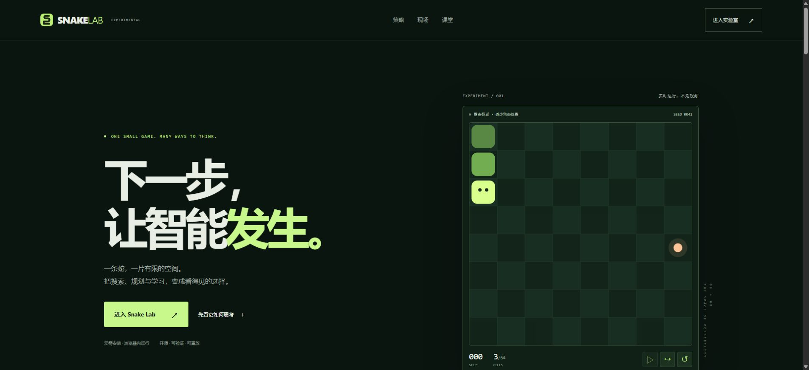
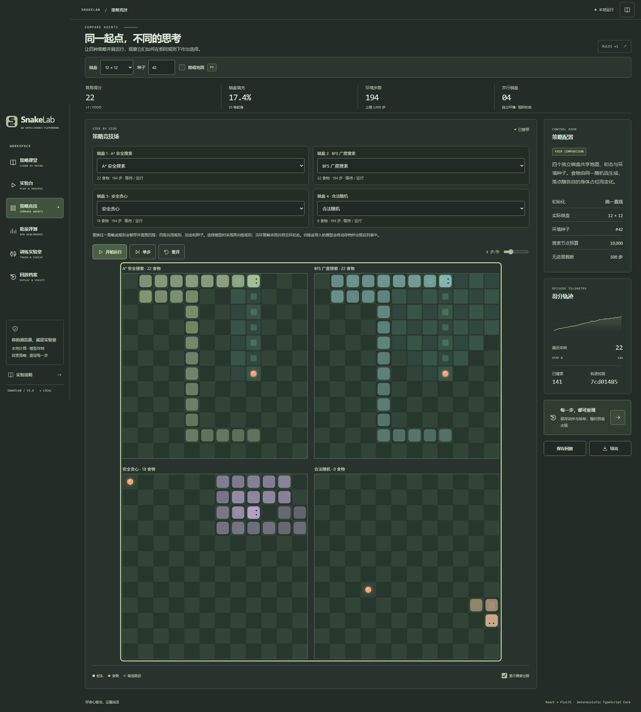
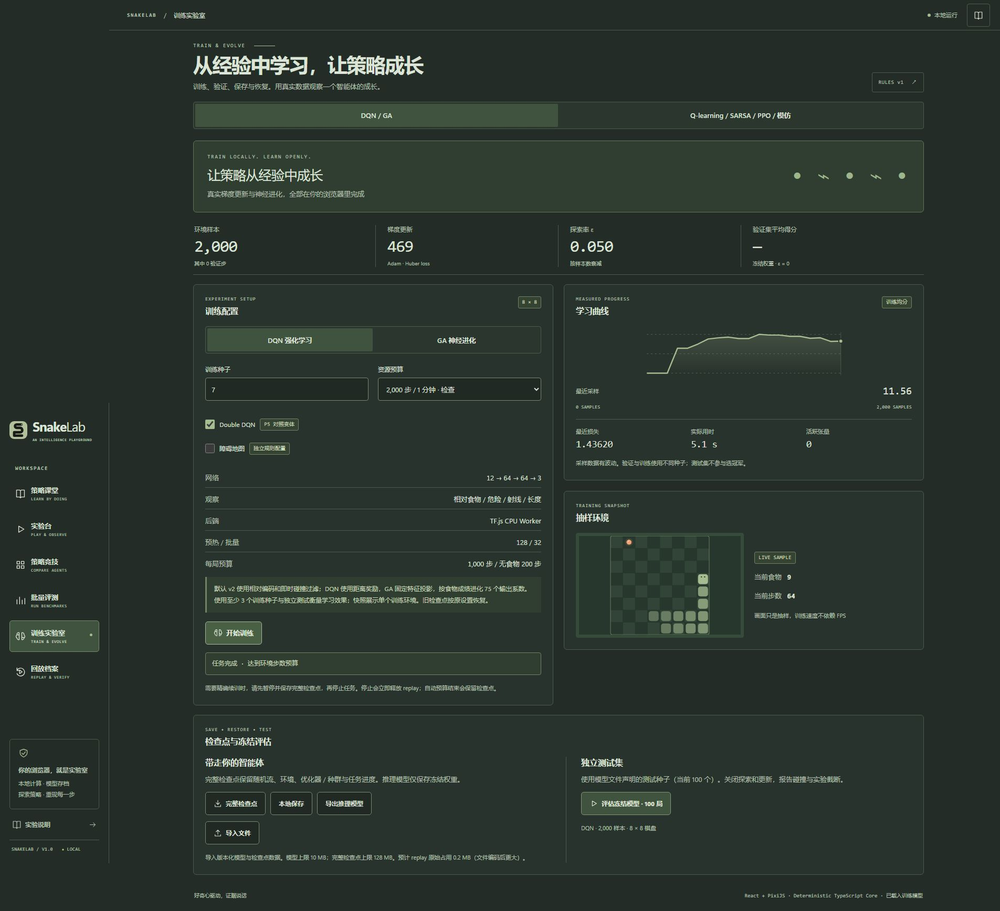
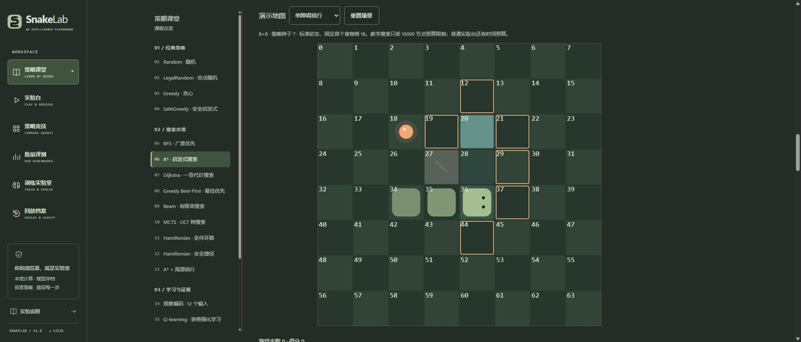

# SnakeLab · Snake Game Lab

**一条蛇，一个可以观察、比较、训练与重放的智能实验室。**

[**在线体验 →**](https://snake-game-lab.9992099.xyz/) · [**直接进入 Lab →**](https://snake-game-lab.9992099.xyz/#/lab) · [策略课堂](https://snake-game-lab.9992099.xyz/#/lessons) · [运行与验证](#快速开始)



根入口是品牌页：观察真实策略、比较决策方式、观看项目实录，再进入独立的 **Lab 工作区**。Lab 将手动游戏、自动策略、四路竞技、批量评测、浏览器训练与回放放在统一的确定性规则核心上。无需账号或外部模型服务。

> 本页四张截图于 **2026-10-15** 从正式 HTTPS 站点使用本机 Chrome 截取，仅包含公开产品界面。首屏截图遵循当前浏览器的“减少动态效果”偏好，显示静态预览；其他图为真实交互后的状态。点击图片可查看原图；[截图与核验记录](docs/deployed-site-tour.md)说明参数和边界。

## 从观看到实验

| 入口 | 可以做什么 |
| --- | --- |
| [品牌页](https://snake-game-lab.9992099.xyz/) | 实时安全捷径演示、三种策略比较、两段项目原始录像与工作区导航 |
| [实验台](https://snake-game-lab.9992099.xyz/#/lab) | 手动 / AI、单步、暂停、重开、种子与规则、路径 / 搜索可视化、保存回放 |
| [策略竞技](https://snake-game-lab.9992099.xyz/#/arena) | 四个独立环境共享规则、初态与种子，分别选择策略或已存档模型 |
| [训练实验室](https://snake-game-lab.9992099.xyz/#/training) | Worker 内实际训练、预算控制、检查点恢复、模型导入导出与冻结评估 |
| [批量评测](https://snake-game-lab.9992099.xyz/#/batch) | 共同种子比较、失败 / 截断分类、分布、配对差与 95% CI、JSON / CSV 导出 |
| [回放档案](https://snake-game-lab.9992099.xyz/#/replay) | 保存动作、配置、版本与逐步状态哈希，本地存档和文件导入 |

### 并肩观察，再用证据比较

<table>
<tr>
<td width="50%"><a href="docs/images/deployed-arena.jpg"></a></td>
<td width="50%"><a href="docs/images/deployed-training.jpg"></a></td>
</tr>
<tr>
<td><strong>四路策略竞技</strong><br>12 × 12，种子 42，第 194 步暂停。A* / BFS / 安全贪心 / 合法随机分别获得 22 / 22 / 18 / 0 食物。这是一局过程快照，不是算法排名；同一随机流的食物落点还受各自身占位影响。</td>
<td><strong>本地训练与检查点</strong><br>8 × 8，种子 7，Double DQN，2,000 样本检查预算已完成，469 次梯度更新。曲线来自真实采样；本次未执行独立测试，也未产生验证集成绩，不据此声称模型已学会通关。</td>
</tr>
</table>

### 读原理，也能推进一次真实搜索

[](docs/images/deployed-classroom.jpg)

[策略课堂](https://snake-game-lab.9992099.xyz/#/lessons)有 **21 课、42 份 JavaScript / Python 代码**，包含术语、手算、真实引擎交互、代码对照、适用边界、练习与来源。上图是 [A* 课](https://snake-game-lab.9992099.xyz/#/lessons/astar)的第 3 / 5 搜索帧：棋盘保持冻结，扩展格 20，`g=2, h=2, f=4`；只有执行建议动作才推进游戏。

## 策略与课程路线

| 路线 | 已实现内容 | 需要理解的边界 |
| --- | --- | --- |
| 经典规则 | Random、Legal Random、Greedy、Safe Greedy | 眼前合法或空间较大，不等于长期安全 |
| 搜索与规划 | BFS、A*、Dijkstra、Greedy Best-First、有限 Beam、UCT MCTS、A* + 尾部绕行 | 静态最短路不等于动态蛇身通关；节点 / 时间预算可能导致回退 |
| 有序环 | Hamiltonian 环、Hamiltonian 安全捷径 | 需要无障碍、可构造覆盖环的尺寸及正确沿环初态；有限预算仍可能截断 |
| 学习与进化 | Q-learning、SARSA、DQN / Double DQN、GA、PPO-Clip、行为克隆 | 真实参数更新；短训练不保证学会，需多个训练种子和独立测试 |
| 实验方法 | 12 维观察编码、训练 / 验证 / 测试划分、冻结评估、回放核验 | 训练曲线不能代替独立评估；教学构件不等同于完整生产策略 |

课程分为「经典策略」「搜索决策」「学习与证据」三组，支持独立深链、前后课导航、语言切换和原文复制。详见 [教学记录](docs/algorithm-lessons.md)与[课堂内容验收](docs/classroom-redesign.md)。

## 首次进入与用户控制

首次进入 `#/lab`，默认自动运行 **Hamiltonian 安全捷径**：8 × 8、无障碍、沿环初态、种子 42、20 步/秒，5,000 步及 500 步无食物预算。此配置经真实引擎与逐步回放验证：**675 步、61 食物、64 格填满，终局哈希 `19e52bf6`**。完成后保留成功状态，不自动重播；实际完成时间取决于设备渲染速度。

暂停、重开、手动游玩、策略与规则切换始终由用户控制。回访读取经过校验的 `snake-lab-play-v1` 偏好并保持暂停；`#/play`、课堂等指定深链不会被演示覆盖。启用“减少动态效果”时首次演示保持暂停；实验台切到后台即暂停，返回前台需手动继续。品牌页不修改实验区偏好。存储受限时仍可使用，但偏好可能无法跨访问保留。

安全捷径的多种子结果见[通关效率报告](docs/efficient-completion.md)：原报告的 8 / 12 / 20 三种尺寸在充足预算下各 30 / 30 填满，步数较纯环约减少 36% / 44% / 47%；20 × 20 在 5,000 步预算下全部截断。这些是指定协议的结果，不是任意模式必胜或“所有算法里最强”的承诺。

## 快速开始

推荐 **Node 24.15+（24.x）**；完整支持范围见 `package.json`，精确依赖见 `package-lock.json`。

```sh
git clone https://github.com/ider-zh/snake-game-lab.git
cd snake-game-lab
npm ci
npm run dev
# http://127.0.0.1:5173
```

```sh
npm run check          # TypeScript + ESLint + Vitest + production build
npm run preview        # 生产构建预览，需先完成 build / check
npx playwright install chromium
npm run test:e2e        # 桌面 + 手机尺寸 Chromium 工作流
# 重点回归：
npm run test:e2e -- tests/brand.spec.ts tests/welcome.spec.ts tests/lab.spec.ts
```

开发 / 预览默认只绑定回环地址。Playwright 默认独占 `127.0.0.1:4187`，不复用未知服务，并从 `public/_headers` 应用生产响应头。受限环境可为 npm 指定一个可写的 `--cache` 目录。

## 技术与数据边界

- **纯 TypeScript 核心**：手动、AI、训练与评测共用 `Game.step` 语义；动作、种子和哈希支持确定性回放。仅节点预算模式用于严格动作重现，墙钟预算受设备负载影响。
- **React + PixiJS**：实验区按需加载，PixiJS 单画布最多绘制四局；品牌首屏直接调用相同引擎，以 SVG 展示。两段自录 WebM 共 722,113 字节，带 poster、可见性加载 / 暂停、手动暂停、错误回退和 reduced motion 替代。
- **Web Workers**：批量仿真与训练隔离于 UI。DQN / Double DQN 使用 TF.js CPU、目标网络、紧凑 replay、Huber loss 和 Adam；GA 使用种群、锦标赛、精英、交叉与变异。PPO 与行为克隆是独立线性策略，不宣传大型神经网络能力。
- **本地数据**：没有应用账号、后端训练服务、应用遥测或外部模型下载。模型与回放存在浏览器；清理站点数据会删除 IndexedDB 存档，应导出备份。不同 origin 的数据不会自动迁移。
- **续训**：精确续训需先暂停并导出完整检查点。停止会释放 replay；正常预算结束保留可导出的检查点。推理模型与完整检查点用途不同。
- **严格 CSP**：`script-src 'self'` 不放开动态执行。Board 初始化前导入官方 `pixi.js/unsafe-eval` 静态兼容模块，其名称不代表允许 CSP `unsafe-eval`；错误文案区分 CSP、图形上下文与其他异常。[PixiJS 官方说明](https://github.com/pixijs/pixijs/blob/dev/skills/pixijs-environments/SKILL.md#csp-compliant-setup)。

新建 8 × 8 DQN / GA 任务使用 v2 的 **12 维相对特征与即时碰撞过滤**：DQN 为 `12 → 64 → 64 → 3`，带距离奖励；GA 固定特征投影，进化 75 个输出系数。终止不 bootstrap，新预设也不对截断 bootstrap。训练、验证、测试种子分离，冻结评估不更新权重；旧模型 / 检查点按原编码恢复。历史设计中的全棋盘编码不代表当前默认配置。真实学习对照、失败试验及预算见[训练有效性报告](docs/training-effectiveness.md)。

## 验证范围

| 证据 | 范围与限制 |
| --- | --- |
| [品牌页验收](docs/brand-landing-validation.md) | `e9fdaf1` 本地 Windows：typecheck、lint、132 项单元测试、生产构建通过；品牌 / 首访 / Lab 共 24 项桌面与手机尺寸 Chromium 用例通过，媒体生命周期又单独复验 |
| [首访与 CSP 验收](docs/welcome-demo-validation.md) | 生产响应头下初始化、首次自动演示、回访、手动控制、675 步终局与哈希；后台测试为可见性事件合同，非全部操作系统场景 |
| [正式站点截图核验](docs/deployed-site-tour.md) | 本次浏览 HTTPS 品牌 / Lab / 竞技 / 训练 / A* 课堂，执行短训练与搜索单步；仅文档更新，未重跑全套应用测试或全部学习算法 |
| [GitHub Actions](https://github.com/ider-zh/snake-game-lab/actions) | 云端状态以对应提交的实际 run 为准；旧 `de71d2d` 桌面实时通关曾超时，`e9fdaf1` 已拆分测试并调整预算。本页不把本地通过等同于云端全绿 |

历史 HP 验收、性能与策略测评仅适用于各报告标明的版本、设备与协议。手机尺寸 Chromium 检查不等于所有实体移动设备或所有浏览器覆盖。

## 部署

正式站点：[snake-game-lab.9992099.xyz](https://snake-game-lab.9992099.xyz/)。维护者已配置 GitHub main 的 Auto Deploy；后续推送可能自动发布，是否完成以部署平台为准。

这是纯静态 Vite 应用：构建命令 `npm run build`，输出目录 `dist`，Node 24.15+（24.x）。仓库提供 `public/_headers`、`public/_redirects` 与 `wrangler.jsonc`，应用无需云函数、数据库或 API token。工作区使用 hash 路由，`/#/lab`、`/#/arena`、`/#/lessons/astar` 等可直接访问和刷新。托管服务的套餐与费用由维护者选择。详见[部署说明](docs/deployment.md)。

## 深入阅读

| 主题 | 文档 |
| --- | --- |
| 总体设计与维护 | [设计计划](docs/design-plan.md) · [实现记录](docs/implementation.md) · [维护约定](AGENTS.md) |
| 策略证据 | [安全捷径](docs/efficient-completion.md) · [尾部绕行：240 局与限制](docs/tail-detour.md) · [Dijkstra / Beam / MCTS 等规划策略](docs/planning-policies.md) |
| 训练证据 | [训练有效性与兼容性](docs/training-effectiveness.md) · [Q-learning / SARSA](docs/tabular-learning.md) · [PPO / 行为克隆](docs/policy-learning.md) |
| 历史验收 | [HP 验证](docs/hp-validation.md) · [视觉审查](docs/visual-review.md) · [最终交接](docs/final-handoff.md) · [用户反馈修复](docs/repair-report.md) |
| 教学与展示 | [算法教学](docs/algorithm-lessons.md) · [课堂改版及代码验收](docs/classroom-redesign.md) · [品牌页与媒体出处](docs/brand-landing-validation.md) |

## 参考与许可

- [dmitryshelomanov/snake](https://github.com/dmitryshelomanov/snake)：TypeScript / React 贪吃蛇及搜索可视化，借鉴策略接口与手动 / AI 共用规则的组织思路。
- [gargimahale/Snake](https://github.com/gargimahale/Snake)：Python / Tkinter 项目，借鉴安全检查、实验模式与训练 / 评估划分。

研究来源见[参考文档](docs/references.md)。历史核查时上述两个仓库均未见 LICENSE；本项目仅借鉴设计理念，未复制其源码或沿用其成绩。**本仓库许可证尚待维护者决定**，不因源码公开而推定额外授权。


## 2026-10-15：更名与首页播放修复

当前项目名为 **Snake Game Lab**，仓库为 [ider-zh/snake-game-lab](https://github.com/ider-zh/snake-game-lab)，官方入口为 https://snake-game-lab.9992099.xyz/ 。历史截图与验收记录保留采集时的名称和域名，不代表已在新域名重跑。新域名的浏览器存储独立，旧站存档不会自动迁移。

首页可见时在普通与减少动态效果两种偏好下均自动推进，无需点击。减少动画仅关闭非必要装饰、闪烁与过渡；棋盘保留真实步进和暂停按钮。手动暂停不会被重渲染、偏好切换或前台恢复覆盖；刷新和重新进入首页默认开局。实验台已保存设置仍以暂停方式恢复。Cloudflare 统计脚本被严格 CSP 拦截不影响核心游戏；未放宽 CSP。实现与本次实际验收见 [播放修复记录](docs/autoplay-fix-validation.md)。
